<div align="center">

# ☕ Mello — A brighter kind of coffee break

**A pixel-perfect React + TypeScript implementation of the Mello specialty-coffee landing page.**

Same layout, same typography, same motion — across desktop, tablet and mobile.

[](https://hypeer.cloud/mello/)
[](https://github.com/SamalehZen/mello-framer/actions/workflows/ci.yml)


</div>

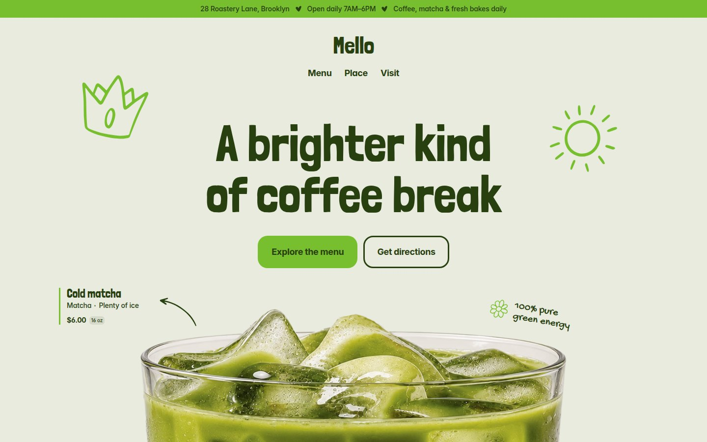

---

## ✨ Overview

Mello is a fast, accessible marketing site for a Brooklyn coffee shop. It ships
as a single-page React app with ten distinct sections, a CSS-driven marquee and
a full set of responsive, motion-rich interactions — all built to match the
reference design down to the pixel.

- **Pixel-accurate** — geometry, font metrics and colours verified against the
  reference at `320 / 390 / 768 / 1024 / 1440 px`.
- **Motion-rich** — staggered word reveals, spring-eased cards, an interactive
  flavour wheel, a carousel and idle doodle animations.
- **Accessible** — WCAG AA contrast, keyboard operable controls, a skip link and
  a full `prefers-reduced-motion` fallback.
- **Lightweight** — no animation framework; motion is pure CSS keyframes and
  `linear()` springs.

---

## 🧩 Sections

| Section          | What it does                                                           |
| ---------------- | ---------------------------------------------------------------------- |
| **Info bar**     | Scrolling address / hours strip (static on desktop, marquee on mobile) |
| **Header**       | Logo + nav with animated hover pills                                   |
| **Hero**         | Staggered headline, CTAs, matcha artwork, doodles & product badge      |
| **Ticker**       | Infinite CSS marquee with heart separators (×3)                        |
| **Products**     | Four-up product grid with scroll-reveal cards                          |
| **Menu**         | Full menu — six categories with prices and volumes                     |
| **Mood**         | Interactive flavour wheel that swaps a detail card                     |
| **Time**         | Opening-hours card with switchable day tabs                            |
| **Philosophy**   | Perforated “receipt” ticket with floating hearts & barcode             |
| **Atmosphere**   | Photo explorer with clickable hotspots and 5s autoplay                 |
| **Testimonials** | Autoplaying carousel with spring-eased card transitions                |
| **Visit**        | Address, hours and photo panes with staggered reveal                   |
| **Footer**       | Links, contact icons and an animated logo                              |

---

## 📸 Gallery

<table>
  <tr>
    <td width="50%">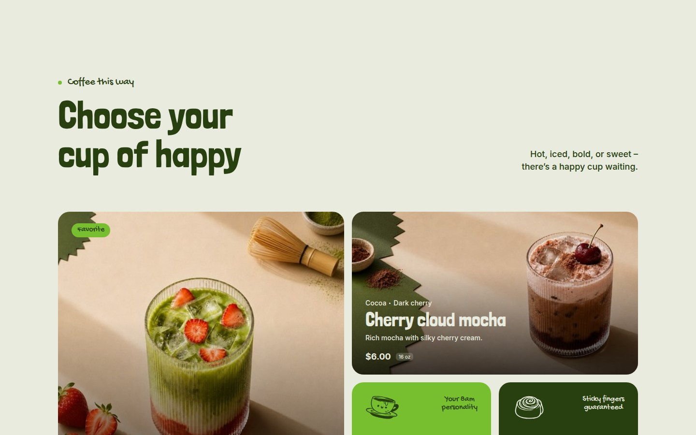</td>
    <td width="50%">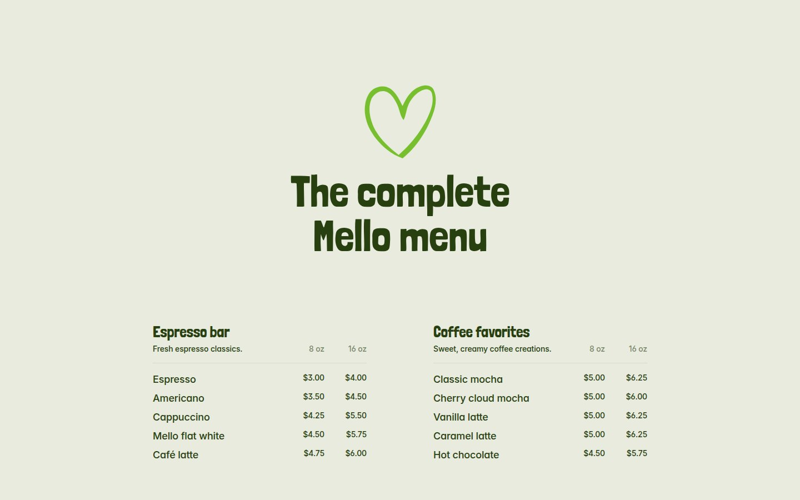</td>
  </tr>
  <tr>
    <td width="50%">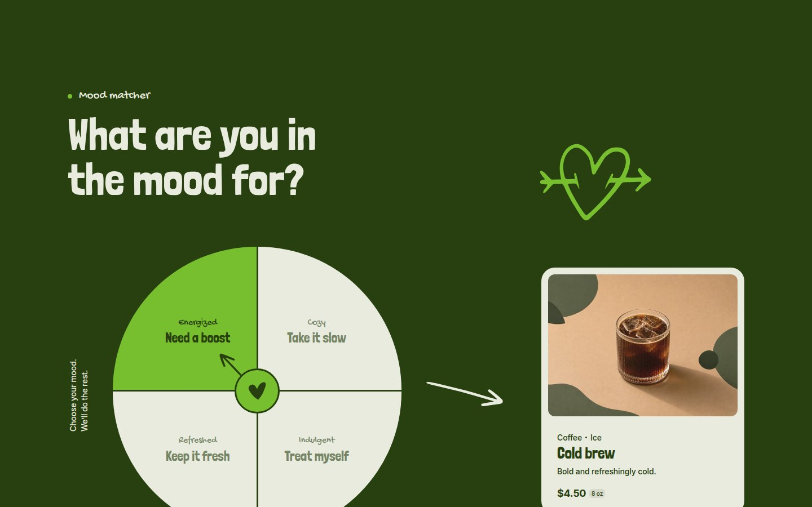</td>
    <td width="50%">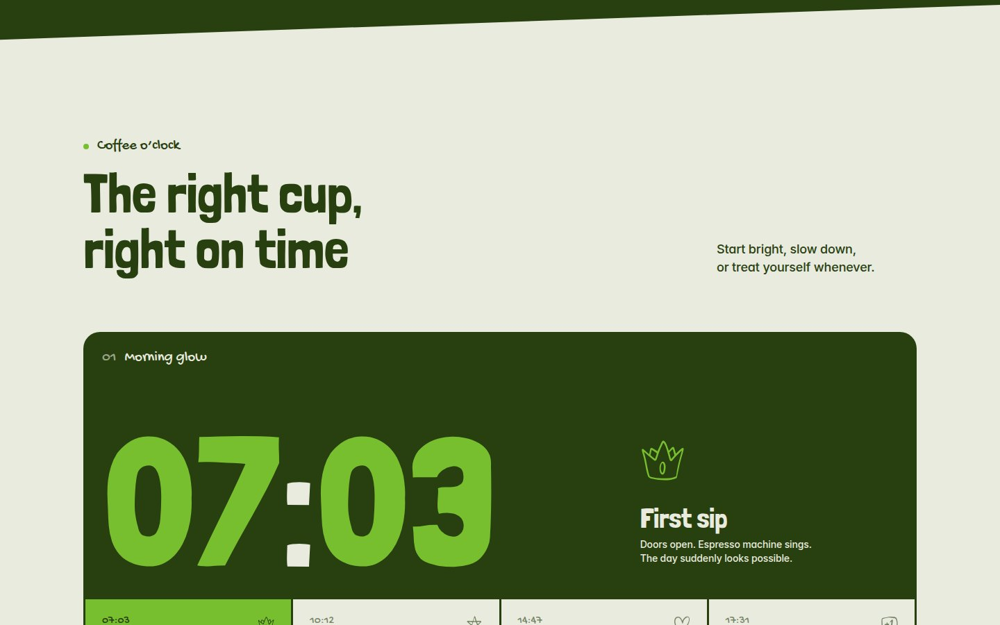</td>
  </tr>
  <tr>
    <td width="50%">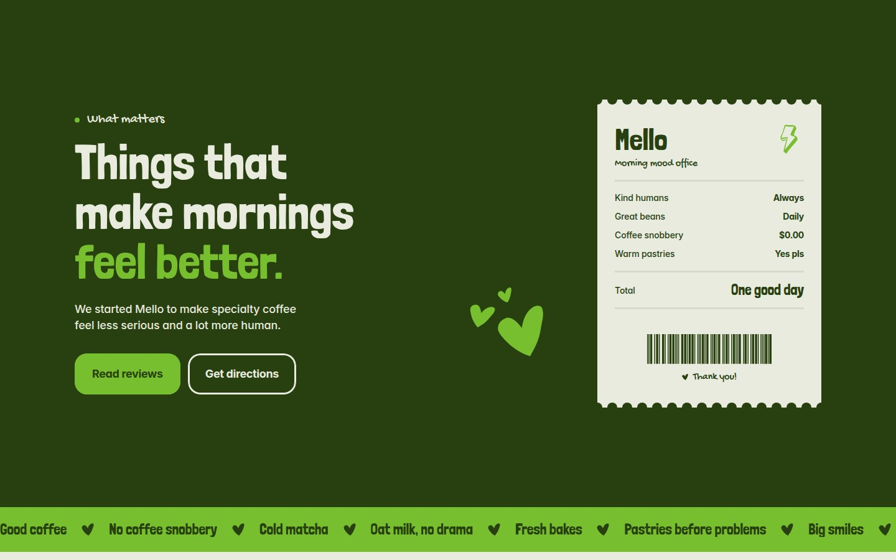</td>
    <td width="50%">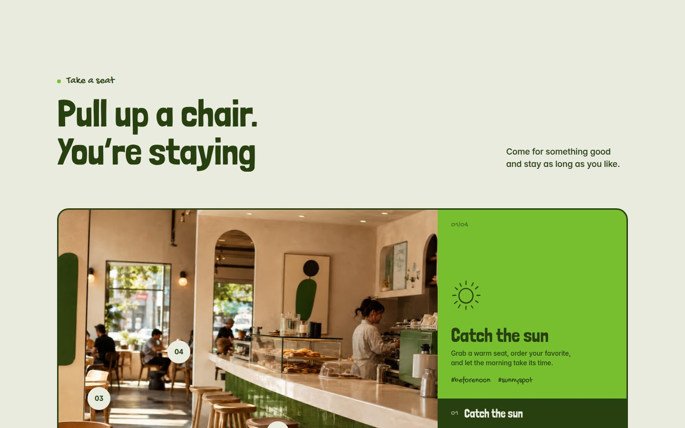</td>
  </tr>
  <tr>
    <td width="50%">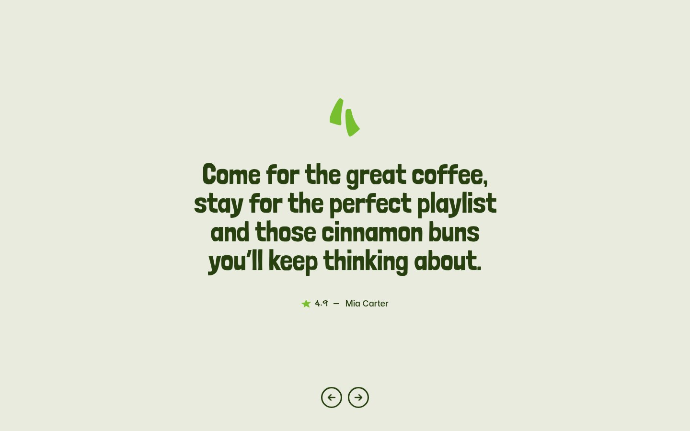</td>
    <td width="50%">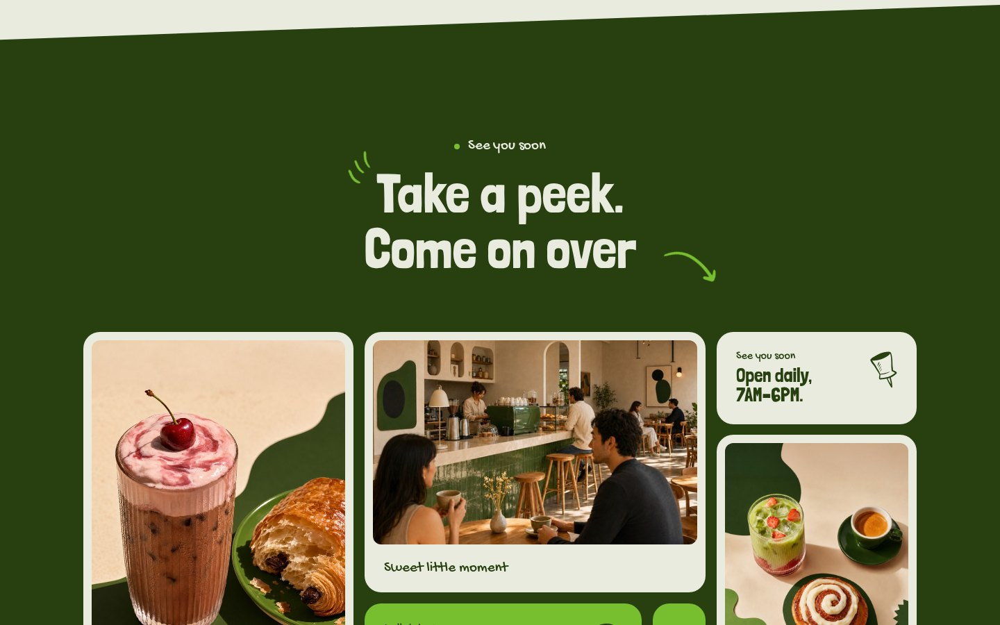</td>
  </tr>
  <tr>
    <td width="50%">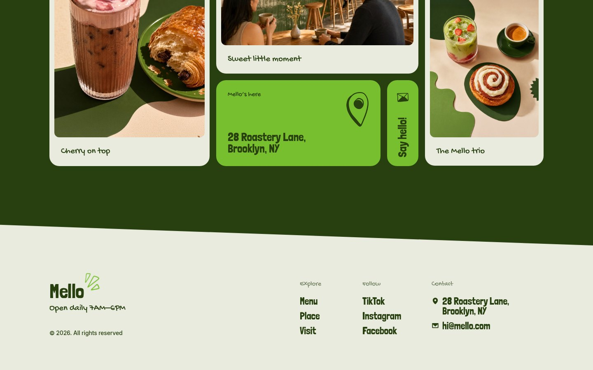</td>
    <td width="50%"></td>
  </tr>
</table>

### 📱 Fully responsive

<table>
  <tr>
    <td width="280">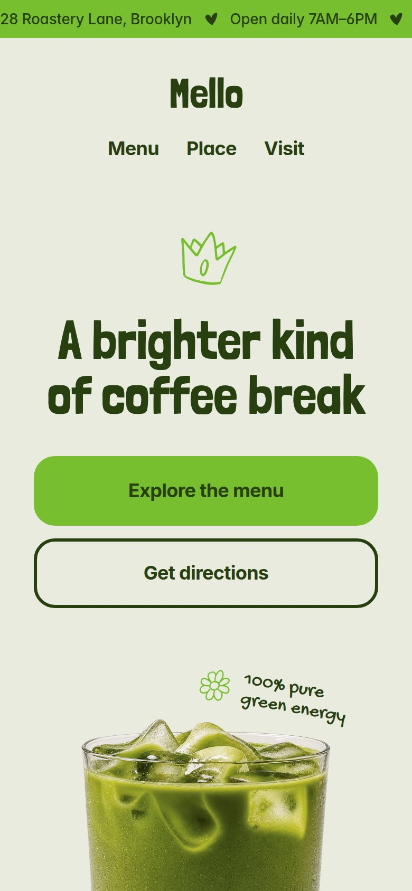</td>
    <td valign="top">

Breakpoints mirror the design:

- **Mobile** — `≤ 767.98 px`
- **Tablet** — `768 – 1199.98 px`
- **Desktop** — `≥ 1200 px`

Layouts, type scale and spacing are all re-measured per breakpoint rather
than blanket-scaled, so each viewport is genuinely first-class.

  </td>
  </tr>
</table>

---

## 🛠 Tech stack

| Layer   | Choice                                                        |
| ------- | ------------------------------------------------------------- |
| Build   | **Vite 7**                                                    |
| UI      | **React 19** + **TypeScript 5.9** (strict)                    |
| Styling | Hand-written CSS with custom properties                       |
| Fonts   | Self-hosted **Londrina Solid**, **Gochi Hand**, **Inter**     |
| Motion  | CSS keyframes, `linear()` springs, `IntersectionObserver`     |
| Testing | **Vitest** + **Testing Library**, **Playwright** + **axe**    |
| Quality | **ESLint** (typescript, react-hooks, jsx-a11y) + **Prettier** |

---

## 🧪 Quality gates

Every change is expected to pass the same checks that CI runs:

| Check        | Command                | Tool                                |
| ------------ | ---------------------- | ----------------------------------- |
| Types        | `npm run typecheck`    | `tsc --noEmit`, strict mode         |
| Lint         | `npm run lint`         | ESLint + react-hooks + jsx-a11y     |
| Formatting   | `npm run format:check` | Prettier                            |
| Unit / hooks | `npm test`             | Vitest + Testing Library (`jsdom`)  |
| End-to-end   | `npm run test:e2e`     | Playwright against the built bundle |

The Playwright suite runs at **desktop, tablet and mobile** sizes and does two
things per viewport:

1. **Visual regression** — one snapshot per section, so a diff points straight
   at the section that changed instead of a 14 000 px-tall page.
2. **Accessibility audit** — an [`axe-core`](https://github.com/dequelabs/axe-core)
   scan must report zero violations.

A React **error boundary** at the root turns an unexpected render crash into a
branded recovery screen rather than a blank page.

---

## 🚀 Getting started

```bash
npm install
npm run dev            # start the dev server
npm run typecheck      # strict type check (tsc --noEmit)
npm run lint           # eslint
npm run format         # prettier --write
npm run build          # production build (tsc -b && vite build)
npm run preview        # serve the production build
npm test               # unit tests
npm run test:e2e       # playwright (builds + previews automatically)
```

Requires **Node 20+**. The visual baselines are Linux/Chromium specific; CI
uses the same Playwright version so they stay comparable.

---

## 📁 Project structure

```
src/
├─ app/
│  ├─ App.tsx             # page composition (sections + tickers)
│  └─ ErrorBoundary.tsx   # top-level crash recovery screen
├─ config/site.ts         # single source of truth for shop details
├─ sections/              # one component per page section
├─ components/Marquee     # CSS-driven infinite marquee
├─ hooks/
│  ├─ useMediaQuery.ts    # shared breakpoint hook
│  └─ useReveal.ts        # shared IntersectionObserver reveal
├─ styles/
│  ├─ index.css           # tokens, @font-face, base reset, skip link
│  └─ sections.css        # section layout, responsive & motion CSS
├─ test/setup.ts          # jsdom shims for observers / matchMedia
└─ assets/                # self-hosted fonts, AVIF/WebP/JPEG/PNG artwork
e2e/                      # Playwright specs + per-section snapshots
scripts/optimize-images.mjs  # regenerates the AVIF/WebP siblings
docs/
├─ screenshots/           # README captures
└─ reconstruction-notes.md
```

---

## ♿ Accessibility

- **Contrast** — every text/background pairing meets **WCAG AA** (`4.5:1` for
  body copy, `3:1` for large text); verified by axe at all three breakpoints.
- **Keyboard** — a skip link jumps past the nav, and every control (tabs,
  hotspot buttons, carousel) is reachable and operable.
- **Reduced motion** — `prefers-reduced-motion: reduce` disables reveals,
  autoplay and idle animations, rendering content in its final state.
- **Screen readers** — decorative art and the duplicated marquee track are
  `aria-hidden`; interactive sections expose names and state.

---

## ⚡ Performance

- **Modern images** — the hero, product and visit photos are served as
  **AVIF → WebP → JPEG/PNG** via `<picture>`, cutting image weight by roughly
  55–75 % on supporting browsers. Variants are reproducible with
  `node scripts/optimize-images.mjs`.
- **No layout shift** — every raster image declares `width`/`height`; the hero
  art loads eagerly with `fetchPriority="high"` and the rest decode lazily.
- **Caching** — React is split into a stable `vendor` chunk so app-only
  deploys keep the cached runtime, and small decorative SVGs are inlined.
- **Fonts** — self-hosted `woff2` with `font-display: swap`; no third-party
  requests.

---

## 📐 Responsive & motion

- Section reveals are driven by a shared **`IntersectionObserver`** hook and
  toggled with `.is-in` classes, so nothing animates until it enters the
  viewport.
- The ticker is a pure-CSS translation whose duration derives from a target
  pixel speed, keeping it consistent at every width.
- All animations and transitions are disabled under
  **`prefers-reduced-motion: reduce`**; content renders in its final state.

---

## 🌍 Deployment

The build honours a configurable base path, so it can be served from a
subdirectory:

```bash
BASE=/mello/ npm run build
# copy the emitted files (default: dist/) to your web root
```

The head metadata (`index.html`), `robots.txt` and `sitemap.xml` target
`https://hypeer.cloud/mello/`; update those URLs if the site moves.

---

## 🔍 Reconstruction notes

This project was built with a measurement-driven, pixel-perfect workflow:
a headless Chromium harness compared the build against the reference at every
breakpoint (geometry, computed styles, screenshot diffs, animation timing).
See [`docs/reconstruction-notes.md`](docs/reconstruction-notes.md) for details.

> **Note on history:** the Git history was reconstructed from a single working
> snapshot. Commits are organised by feature and concern for readability, but
> their order and timestamps reflect the reconstruction — not the original
> development timeline.

---

## 📄 License

Proprietary. All rights reserved.
